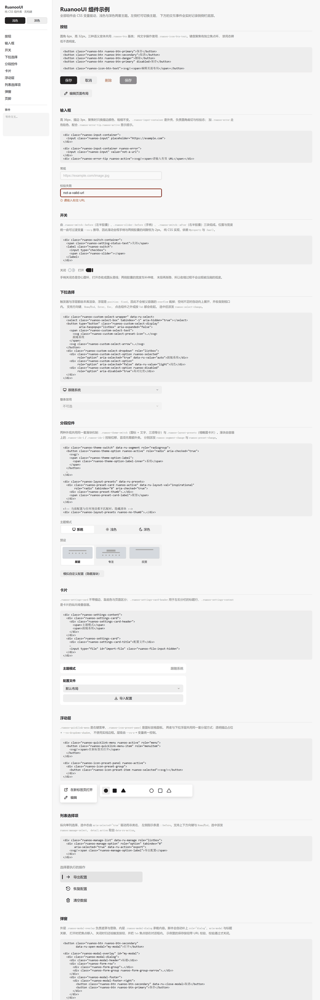
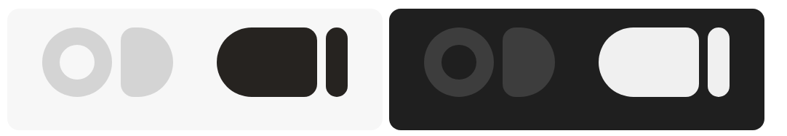
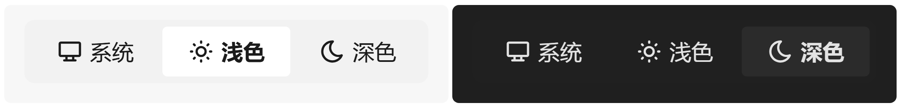

# RuanooUI

轻量的纯 CSS 组件库。零依赖、无构建，`<link>` 引入即可使用，颜色全部挂在 CSS 变量上，自带浅色与深色两套主题。



## 特性

- **零构建、零依赖** — 没有打包步骤，没有运行时依赖，直接引用源文件
- **双主题** — 浅色 / 深色由 `<html data-ru-theme>` 切换，全部颜色可覆盖
- **命名空间隔离** — 类名统一 `ruanoo-` 前缀，变量统一 `--ru-` 前缀，`data-ru-*` 作为行为钩子，不会与应用自身的样式互相干扰
- **样式与脚本分离** — 只用 CSS 也可以，交互脚本可选

## 文件

| 文件 | 说明 |
| --- | --- |
| `ruanoo-ui.css` | **组件库本体**：设计变量与全部组件规则 |
| `ruanoo-ui.js` | 交互脚本：主题、下拉、分段控件、列表选择项、弹窗 |
| `index.html` | 组件示例页，可直接打开，无需服务器 |
| `tools/audit.mjs` | 一致性审计：交叉检查类名、变量、关键帧与钩子的引用完整性 |
| `tools/selftest.html` | 交互自检页，覆盖全部组件的键盘与事件行为 |

## 快速开始

```html
<!DOCTYPE html>
<html lang="zh-CN" data-ru-theme="light">
<head>
  <meta charset="UTF-8">
  <link rel="stylesheet" href="ruanoo-ui.css">
</head>
<body>
  <button class="ruanoo-btn ruanoo-btn-primary">保存</button>

  <script src="ruanoo-ui.js"></script>
</body>
</html>
```

省略脚本时 `ruanoo-ui.css` 依然完整可用，只是下拉、分段控件与弹窗不会响应交互。

### 避免主题闪烁

主题会写入 `localStorage`。把下面这段放在 `<head>` 中同步执行，深色用户才不会先看到一帧浅色：

```html
<script>
  (function () {
    try {
      var saved = localStorage.getItem('ruanoo-ui-theme');
      if (saved === 'dark' || saved === 'light') {
        document.documentElement.dataset.ruTheme = saved;
      }
    } catch (e) { /* 隐私模式下 localStorage 可能不可用 */ }
  })();
</script>
```

## 主题

由 `<html>` 上的 `data-ru-theme` 驱动：

```html
<html data-ru-theme="light">   <!-- 浅色，也是默认值 -->
<html data-ru-theme="dark">    <!-- 深色 -->
```

脚本会自动接管带 `data-ru-set-theme` 的按钮，并在切换后同步 `.on` 类：

```html
<button data-ru-set-theme="light">浅色</button>
<button data-ru-set-theme="dark">深色</button>
```

手动切换等价于：

```js
document.documentElement.dataset.ruTheme = 'dark';
```

## 设计变量

所有颜色都定义在 `:root`（浅色）与 `:root[data-ru-theme="dark"]`（深色）下。业务侧只需覆盖变量即可整体换肤，不必改动组件规则。

```css
:root {
  --ru-accent-foreground-rest: #1f6feb;   /* 主色换成蓝色系 */
  --ru-accent-foreground-hover: #388bfd;
  --ru-accent-foreground-invert: #ffffff;
}
```

| 分组 | 变量 |
| --- | --- |
| 页面与浮层底色 | `--ru-fill-color`、`--ru-fill-popup-color` |
| 文字 | `--ru-neutral-foreground-rest`、`--ru-neutral-foreground-secondary`、`--ru-placeholder-color` |
| 互动填充 | `--ru-neutral-fill-rest`、`--ru-neutral-fill-hover` |
| 强调色 | `--ru-accent-foreground-rest`、`--ru-accent-foreground-hover`、`--ru-accent-foreground-invert` |
| 按钮 | `--ru-btn-secondary-bg`、`--ru-btn-danger-color`、`--ru-btn-danger-hover` |
| 阴影 | `--ru-shadow16`、`--ru-dropdown-shadow` |
| 浮层层级 | `--ru-z-modal`、`--ru-z-dropdown`、`--ru-z-panel`、`--ru-z-menu` |
| 弹窗与输入框 | `--ru-modal-bg`、`--ru-modal-border`、`--ru-modal-mask`、`--ru-input-bg`、`--ru-input-border`、`--ru-input-border-focus` |
| 卡片与缩略图 | `--ru-settings-card-bg`、`--ru-settings-card-border`、`--ru-settings-card-hover`、`--ru-settings-text-primary`、`--ru-settings-text-secondary`、`--ru-settings-thumb-bg`、`--ru-settings-thumb-border` |
| 字体 | `--ru-font-family` |

`--ru-font-family` 只作为推荐的字体栈提供给使用方（例如设在 `<body>` 上），组件自身一律 `font-family: inherit`，跟随所在上下文的字体。

开关组件内部另有一组由 `@property` 注册的过渡变量（`--ru-p`、`--ru-thumb-left`、`--ru-thumb-w`），由组件自行维护，通常无需覆盖。

## 组件

所有组件圆角统一 6px（内部小元素 3～4px），控件高度以 32 / 36px 为主。

### 按钮

```html
<button class="ruanoo-btn ruanoo-btn-primary">保存</button>
<button class="ruanoo-btn ruanoo-btn-secondary">取消</button>
<button class="ruanoo-btn ruanoo-btn-danger">删除</button>
<button class="ruanoo-btn ruanoo-btn-primary" disabled>保存</button>

<button class="ruanoo-icon-btn-text"><svg/>编辑页面布局</button>
```

| 类名 | 用途 |
| --- | --- |
| `.ruanoo-btn` | 基类：尺寸、内边距、圆角与过渡 |
| `.ruanoo-btn-primary` | 主操作 |
| `.ruanoo-btn-secondary` | 次操作 |
| `.ruanoo-btn-danger` | 危险操作 |
| `.ruanoo-icon-btn-text` | 图标 + 文字的纯文字按钮 |

键盘聚焦时显示 `:focus-visible` 焦点环，`:disabled` 降低不透明度。组件的按钮基线用 `:where()` 限定作用域，不会影响页面上其它 `<button>`。

### 输入框

```html
<div class="ruanoo-input-container">
  <input class="ruanoo-input" placeholder="https://example.com">
</div>

<!-- 校验失败 -->
<div class="ruanoo-input-container ruanoo-error">
  <input class="ruanoo-input" value="bad">
</div>
<div class="ruanoo-error-tip ruanoo-active"><svg/><span>请输入有效 URL</span></div>
```

高 36px、描边 3px。聚焦时只换描边颜色，粗细不变；错误态给容器加 `.ruanoo-error`，并给提示加 `.ruanoo-active`。

### 开关

```html
<div class="ruanoo-switch-container">
  <span class="ruanoo-setting-status-text">关闭</span>
  <label class="ruanoo-switch">
    <input type="checkbox">
    <span class="ruanoo-slider"></span>
  </label>
</div>
```



开关由三个形状组成：`.ruanoo-switch::before` 是左半胶囊、`.ruanoo-slider::before` 是手柄、`.ruanoo-switch::after` 是右半胶囊。位置与宽度全部由可过渡变量 `--ru-p`（0 → 1）推导，因此滑动全程手柄与两侧胶囊的间隙恒为 2px；两半胶囊的圆角采用「垂直半径固定 + 水平半径随宽度收窄」的写法，收缩时弧度不会被压扁。

手柄关闭态是空心圆环，打开态收成圆头竖线。

> 依赖 `@property` 与 `:has()`，需要 **Chrome 105+ / Edge 105+ / Safari 17.2+**。

`.ruanoo-setting-status-text` 只是普通文本节点，内容由使用方自行维护。

### 下拉选择

```html
<div class="ruanoo-custom-select-wrapper" data-ru-select>
  <select class="ruanoo-select-box" tabindex="-1" aria-hidden="true"></select>
  <button type="button" class="ruanoo-custom-select-display"
          aria-haspopup="listbox" aria-expanded="false">
    <span class="ruanoo-custom-select-text">跟随系统</span>
    <svg class="ruanoo-custom-select-arrow">…</svg>
  </button>
  <div class="ruanoo-custom-select-dropdown" role="listbox">
    <div class="ruanoo-custom-select-option ruanoo-selected"
         role="option" aria-selected="true" data-ru-value="auto">跟随系统</div>
    <div class="ruanoo-custom-select-option"
         role="option" aria-selected="false" data-ru-value="light">浅色</div>
    <div class="ruanoo-custom-select-option ruanoo-disabled"
         role="option" aria-disabled="true">高亮（不可选）</div>
  </div>
</div>
```

`data-ru-select` 是交给脚本接管的标记。浮层为 `position: fixed`，不会被父容器的 `overflow` 裁掉；空间不足时向上展开（加 `.ruanoo-drop-up`）并收敛到视口内。

键盘支持方向键、`Home` / `End`、`Enter` / `Space`、`Esc`；点击组件之外或按 `Tab` 会收起。选中后在 wrapper 上派发 `ruanoo:select-change`，`detail.value` 取自 `data-ru-value`（缺省时用选项文本）：

```js
wrap.addEventListener('ruanoo:select-change', function (e) {
  console.log(e.detail.value);
});
```

要在触发器里放图标，用 `.ruanoo-custom-select-preset-icon`。

### 分段控件

**图标 + 文字**：三项等分，滑块位移由容器上的 `.ruanoo-idx-1` / `.ruanoo-idx-2` 控制，首项无需额外类。



```html
<div class="ruanoo-theme-switch" data-ru-segment role="radiogroup">
  <button class="ruanoo-theme-option ruanoo-active" role="radio" aria-checked="true">
    <svg/>…
    <span class="ruanoo-theme-option-label">
      <span class="ruanoo-theme-option-label-inner">系统</span>
    </span>
  </button>
  …
</div>
```

**缩略图卡片**：选中靠 `.ruanoo-active`。

```html
<div class="ruanoo-layout-presets" data-ru-presets>
  <div class="ruanoo-preset-card ruanoo-active" data-ru-layout-val="inspirational"
       role="radio" tabindex="0" aria-checked="true">
    <div class="ruanoo-preset-thumb">
      <div class="ruanoo-preset-thumb-box" style="bottom: 30px"></div>
      <div class="ruanoo-preset-thumb-dots" style="top: 20px"><span></span>…</div>
    </div>
    <span class="ruanoo-preset-card-label">展望</span>
  </div>
</div>
```

缩略图内部可用 `.ruanoo-preset-thumb-box`、`.ruanoo-preset-thumb-logo`、`.ruanoo-preset-thumb-dots` 拼出不同的版式示意。

当当前配置与任何预设都不匹配时，给容器加 `.ruanoo-no-thumb` 即可隐藏滑块。两个组件分别派发 `ruanoo:segment-change`（`detail.index`）与 `ruanoo:preset-change`（`detail.value`）。

长文案不会被截断：脚本量出溢出距离写入 `--ru-label-shift`，超出时给内层文字加 `.ruanoo-overflowing` 触发来回平移。

### 卡片

```html
<div class="ruanoo-settings-content">
  <div class="ruanoo-settings-card">
    <div class="ruanoo-settings-card-title">主题模式</div>
    …内容…
  </div>
  <div class="ruanoo-settings-card">
    <div class="ruanoo-settings-card-header">
      <span>主题模式</span>
      <span>跟随系统</span>
    </div>
  </div>
</div>
```

`.ruanoo-settings-card` 不带描边，靠底色与页面区分。`.ruanoo-settings-card-header` 是左右分栏的标题行，`.ruanoo-settings-content` 是卡片的纵向堆叠容器。

### 浮动层

```html
<!-- 菜单 -->
<div class="ruanoo-quicklink-menu ruanoo-active" role="menu">
  <button class="ruanoo-quicklink-menu-item" role="menuitem">
    <svg/><span>在新标签页打开</span>
  </button>
</div>

<!-- 图标宫格面板 -->
<div class="ruanoo-icon-preset-panel ruanoo-active">
  <div class="ruanoo-icon-preset-group">
    <button class="ruanoo-icon-preset-item ruanoo-selected"><svg/></button>
  </div>
</div>
```

两者与下拉浮层共用同一套分层方式：1px 透明描边占位 + `--ru-dropdown-shadow`，不使用实线边框。

### 列表选择项

```html
<div class="ruanoo-manage-list" data-ru-manage role="listbox">
  <div class="ruanoo-manage-option" role="option" tabindex="0"
       aria-selected="true" data-ru-action="export">
    <svg/><span class="ruanoo-manage-option-label">导出配置</span>
  </div>
</div>
```

选中态由 `aria-selected="true"` 驱动而非类名，左侧指示条是 `::before`。支持上下方向键与 `Home` / `End`，选中后派发 `ruanoo:manage-select`，`detail.action` 取自 `data-ru-action`。

### 弹窗

```html
<div class="ruanoo-modal-overlay" id="my-modal">
  <div class="ruanoo-modal-dialog">
    <div class="ruanoo-modal-header">标题</div>
    <div class="ruanoo-form-row">
      <div class="ruanoo-form-group">
        <label class="ruanoo-form-label">字段</label>
        <div class="ruanoo-input-container"><input class="ruanoo-input"></div>
      </div>
      <div class="ruanoo-form-group ruanoo-form-group-narrow">…</div>
    </div>
    <div class="ruanoo-modal-footer">
      <div class="ruanoo-modal-footer-right">
        <button class="ruanoo-btn ruanoo-btn-secondary" data-ru-close-modal>取消</button>
        <button class="ruanoo-btn ruanoo-btn-primary">保存</button>
      </div>
    </div>
  </div>
</div>

<button data-ru-open-modal="my-modal">打开</button>
```

`:hover` 之外，脚本负责：`data-ru-open-modal` 打开、`data-ru-close-modal` 关闭、点击遮罩关闭、`Esc` 关闭；并自动补上 `role="dialog"`、`aria-modal` 与标题关联，打开时把焦点移入对话框、关闭时归还给触发元素，同时把 `Tab` 焦点锁在对话框内，并锁住背景滚动。

也可手动调用：

```js
RuanooUI.openModal('my-modal');
RuanooUI.closeModal(document.querySelector('.ruanoo-modal-overlay.ruanoo-active'));
```

`.ruanoo-file-input-hidden` 用于隐藏 `<input type="file">`，配合自定义按钮触发。

### 页脚

```html
<div class="ruanoo-settings-footer">
  <div class="ruanoo-settings-footer-links"><a>版本</a>| …</div>
  <div class="ruanoo-settings-footer-links"><a>隐私政策</a> · …</div>
  <div class="ruanoo-settings-footer-text">免责声明</div>
</div>
```

第二行 `.ruanoo-settings-footer-links` 由相邻选择器 `+` 自动调淡。

## JavaScript API

```js
RuanooUI.initAll();          // 初始化全部（页面加载时会自动执行）
RuanooUI.initTheme();
RuanooUI.initSelects();
RuanooUI.initSegments();
RuanooUI.initManageLists();
RuanooUI.initModals();
RuanooUI.initLabelOverflow();
RuanooUI.openModal(id);
RuanooUI.closeModal(el);
RuanooUI.KEY;                // localStorage 键名：'ruanoo-ui-theme'
```

动态插入的内容可以传入作用域单独初始化：

```js
RuanooUI.initSelects(document.getElementById('new-panel'));
```

全局监听只注册一次，重复调用 `initAll()` 不会叠加事件处理器。

### 自定义事件

| 事件 | 触发时机 | `detail` |
| --- | --- | --- |
| `ruanoo:select-change` | 下拉选中某一项 | `{ value }` |
| `ruanoo:segment-change` | 分段控件切换 | `{ index }` |
| `ruanoo:preset-change` | 预设卡片切换 | `{ value }` |
| `ruanoo:manage-select` | 列表选择项切换 | `{ action }` |

所有事件都会冒泡。

## 图标

示例页与自检页中的图标统一取自 [Tabler Icons](https://tabler.io/icons)（MIT）：24 × 24 描边网格，`stroke-width="2"`、`stroke="currentColor"`，随文字颜色变化。需要实心造型时用 `-filled` 变体（如 `circle-filled`）。

组件本身不内置任何图标，换成其它图标集也可以，只要保持用 `currentColor` 着色即可。

## 浏览器支持

- 基础样式：任意现代浏览器
- 按钮基线、焦点环使用了 `:where()`：Chrome 88+ / Safari 14+ / Firefox 78+
- **开关组件**需要 `@property` 与 `:has()`：**Chrome 105+ / Edge 105+ / Safari 17.2+**

更旧的浏览器下仅开关会退化为静态图形，其余组件不受影响。

## 开发

```bash
node tools/audit.mjs          # 一致性审计
node tools/audit.mjs --strict # 有断裂引用时以非零码退出，可用于 CI
```

直接用浏览器打开 `tools/selftest.html` 可以跑一遍交互自检，覆盖下拉、分段控件、列表选择项与弹窗的键盘和事件行为；页面会把结果逐条列出，底部给出通过数。

## 许可

[Apache License 2.0](LICENSE)
